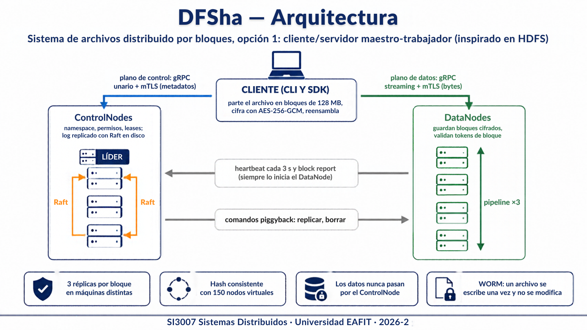
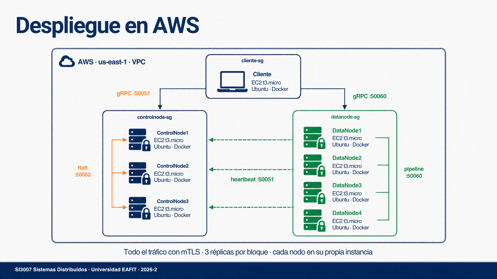
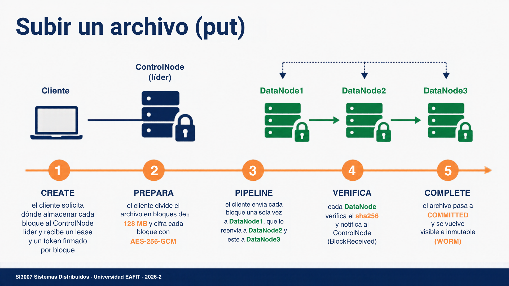
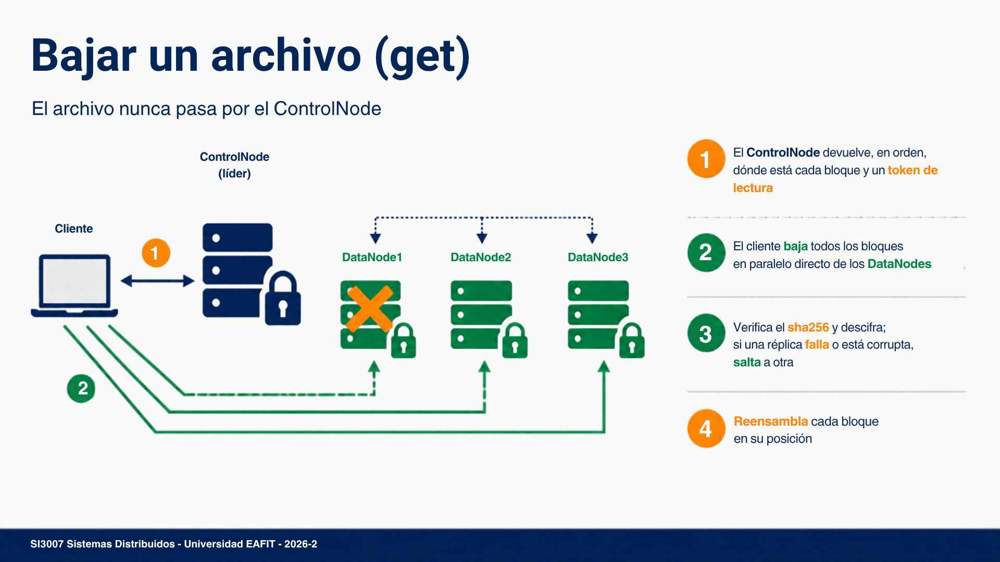
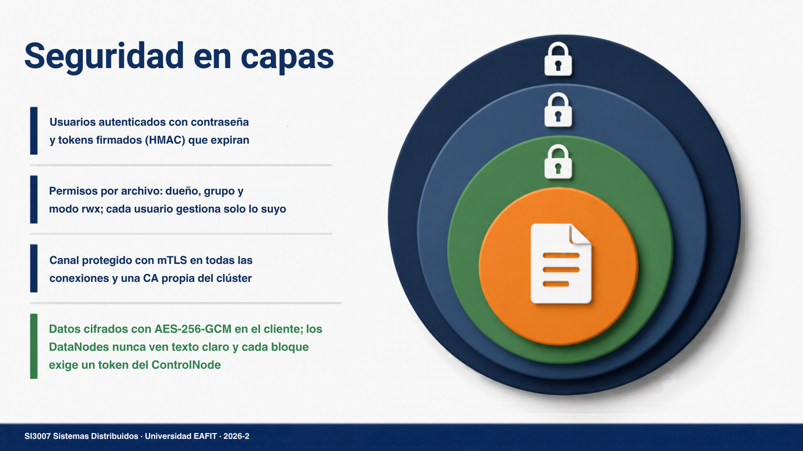
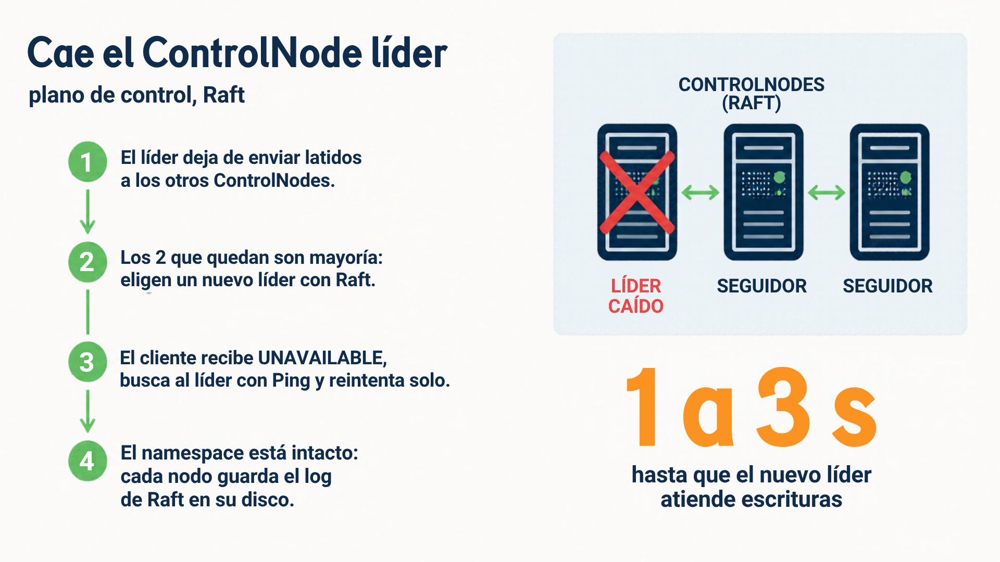
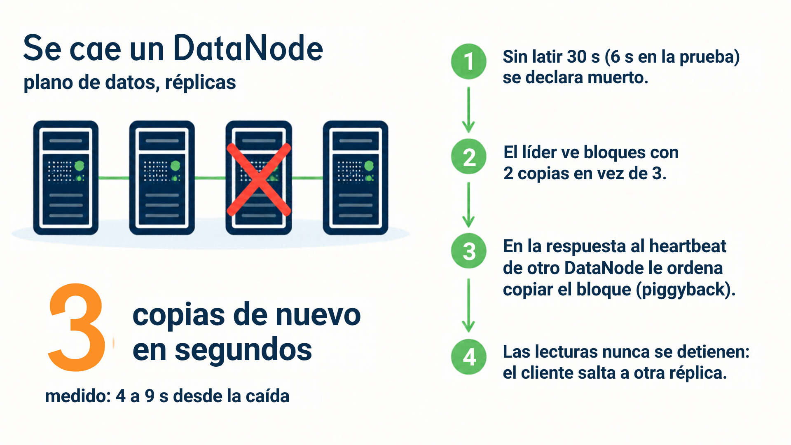
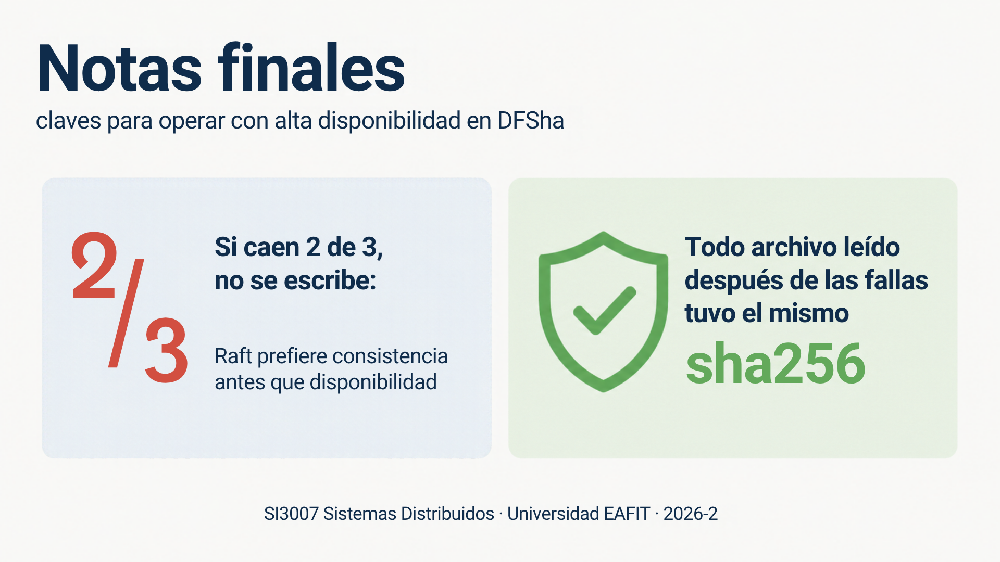

# DFSha — Sistema de archivos distribuido

**Proyecto 1 · SI3007 Sistemas Distribuidos / ST0263 Tópicos Especiales en Telemática · Universidad EAFIT · 2026-2**

DFSha guarda archivos grandes repartidos en varias máquinas. Cada archivo
se parte en bloques, cada bloque se cifra y se guarda en **3 DataNodes**
distintos, y los metadatos viven en **3 ControlNodes** replicados con
**Raft**. Si se cae cualquier máquina, el sistema sigue funcionando y no
se pierde nada.



| | |
|---|---|
| **Arquitectura** | Opción 1: cliente/servidor, maestro–trabajador (inspirado en HDFS) |
| **Comunicación** | gRPC con mTLS en todos los pares; Raft entre ControlNodes |
| **Disponibilidad** | 3 réplicas por bloque, re-replicación automática, 3 ControlNodes con Raft |
| **Seguridad** | AES-256-GCM en el cliente, mTLS, usuarios con contraseña, permisos por archivo, tokens de bloque |
| **Requisitos** | RF1 gestión (`ls`, `cd`, `mkdir`…), RF2 transferencia (`put`, `get`), RF3 acceso (`open`, `read`, `write`, `lock`) |

## Entregables

| Documento | Contenido |
|---|---|
| 📄 [**Informe técnico (PDF)**](docs/informe-tecnico.pdf) | Objetivo, marco teórico, arquitectura, protocolos, algoritmos, entorno, pruebas y resultados |
| [Especificación del servicio](docs/especificacion.md) | Requisitos funcionales y no funcionales, y cómo se cumple cada uno |
| [Protocolos y APIs](docs/protocolos.md) | Los cinco pares de comunicación, mensajes y códigos de error |
| [Decisiones de diseño](docs/decisiones.md) | 20 decisiones: qué se decidió, por qué y qué se descartó |
| [Despliegue](docs/despliegue.md) | Docker en una máquina, notas de AWS y variables de entorno |
| [Imágenes](docs/img) | Arquitectura, despliegue en AWS, flujos, seguridad y alta disponibilidad |

---

## Cómo ejecutarlo

Se necesita **Python 3.10 o superior** y **Git**.

### 1. Instalar

```bash
git clone https://github.com/DrotsGS/Proyecto-1-TDT.git
cd Proyecto-1-TDT
python -m venv venv
venv\Scripts\activate            # Linux / Mac: source venv/bin/activate
pip install -r requirements.txt
python scripts/gen_proto.py
```

### 2. Levantar los nodos en tu PC

Cada nodo es un programa aparte: abre **una terminal por nodo**, entra a
la carpeta del proyecto y activa el `venv` en cada una. Para probar en tu
PC basta con 1 ControlNode y 3 DataNodes. Los comandos son de `cmd` de
Windows; en Linux o Mac usa `export VARIABLE=valor` en vez de `set`.

**Terminal 1, el ControlNode:**

```bat
set PORT=50051
python src/namenode/server.py
```

**Terminales 2, 3 y 4, los DataNodes** (cada uno con su número y su puerto):

```bat
set NODE_ID=dn-1
set PORT=50060
set ADVERTISE_ADDR=localhost:50060
python src/datanode/server.py
```

En la terminal 3 usa `dn-2` y el puerto `50061`, y en la terminal 4,
`dn-3` y el `50062`. Cada DataNode guarda sus bloques en `data/<NODE_ID>`.
En el log del ControlNode verás `[Heartbeat] nuevo DataNode: ...` por
cada uno. `Ctrl+C` apaga cada nodo.

### 3. Usar el cliente

En **otra terminal**:

```bash
python src/client/cli.py login drots          # contraseña: dfsha
python src/client/cli.py mkdir /docs
python src/client/cli.py cd /docs
python src/client/cli.py put foto.jpg foto.jpg
python src/client/cli.py ls
python src/client/cli.py stat foto.jpg
python src/client/cli.py get foto.jpg copia.jpg
```

| Comando | Qué hace |
|---|---|
| `login <usuario>` | inicia sesión y guarda el token |
| `ping` | dice qué ControlNode es el líder |
| `ls [ruta]`, `cd <ruta>`, `pwd` | navegar |
| `mkdir <ruta>`, `rmdir <ruta>`, `rm <ruta>` | crear y borrar |
| `put <local> <remoto>`, `get <remoto> <local>` | subir y bajar archivos |
| `stat <ruta>` | tamaño, bloques, dueño y permisos |
| `chmod <modo> <ruta> [--grupo g]` | cambiar permisos |

Los usuarios están en `deploy/usuarios.json`. Para agregar uno:
`python scripts/usuario.py <usuario> <contraseña>`.

### 4. Usarlo desde Python (RF3)

```python
import sys; sys.path.insert(0, "src")
from client.sdk import DFSha

fs = DFSha(["localhost:50051"])
fs.login("drots", "dfsha")
with fs.open("/docs/notas.txt", "w") as f:     # open + lock
    f.write(b"hola mundo")
with fs.open("/docs/notas.txt") as f:
    f.seek(5)
    print(f.read())                             # b"mundo"
```

---

## Desplegarlo en AWS Academy

Una instancia EC2 por nodo, cada nodo en Docker, con el mismo esquema del
taller de nginx + WordPress del curso: **un docker-compose por rol** y las
IPs en un archivo `.env`.



### 1. Security Groups

En **EC2 → Security Groups**, crea tres:

| Grupo | Puerto | Origen | Para qué |
|---|---|---|---|
| `controlnode-sg` | 50051 | `datanode-sg` y `cliente-sg` | clientes y latidos de los DataNodes |
| `controlnode-sg` | 50052 | `controlnode-sg` | Raft entre ControlNodes |
| `datanode-sg` | 50060 | `datanode-sg` y `cliente-sg` | bloques y pipeline entre DataNodes |
| los tres | 22 | tu IP y `18.206.107.24/29` | SSH y EC2 Instance Connect |

### 2. Instancias

Lanza **8 instancias** `t3.micro` con **Ubuntu 24.04**, en la misma
subred, cada una con su Security Group:

| Nombre | Security Group |
|---|---|
| ControlNode1, ControlNode2, ControlNode3 | `controlnode-sg` |
| DataNode1, DataNode2, DataNode3, DataNode4 | `datanode-sg` |
| Cliente | `cliente-sg` |

Anota la **IP privada** de cada una. Entra a cada instancia con
**Connect → EC2 Instance Connect**.

### 3. Preparar cada instancia (las 8)

```bash
git clone https://github.com/DrotsGS/Proyecto-1-TDT.git
cd Proyecto-1-TDT
bash deploy/setup.sh          # instala Docker
```

### 4. Certificados (en la instancia Cliente)

```bash
sudo apt install -y python3-venv
python3 -m venv venv && source venv/bin/activate
pip install -r requirements.txt
python scripts/gen_proto.py
python scripts/gen_certs.py --carpeta deploy/certs
```

Esto crea la CA y los certificados del mTLS. En **cada ControlNode y
DataNode**, crea la carpeta `deploy/certs` y copia ahí `ca.crt`,
`nodo.crt` y `nodo.key`. Por ejemplo, en el Cliente haz
`cat deploy/certs/ca.crt`, y en el nodo `nano deploy/certs/ca.crt`, pega
el contenido y guarda. Repite con los otros dos archivos. `ca.key` no se
copia a ningún lado.

### 5. Configurar y arrancar cada nodo

En cada ControlNode y DataNode:

```bash
cd deploy
cp .env.ejemplo .env
nano .env                     # tus IPs privadas, ver los comentarios
```

En los ControlNodes:

```bash
sudo docker compose -f docker-compose-namenode.yml --env-file .env up -d --build
sudo docker logs -f dfsha-namenode
```

En los DataNodes:

```bash
sudo docker compose -f docker-compose-datanode.yml --env-file .env up -d --build
```

Cuando los tres ControlNodes estén arriba, uno de ellos mostrará en su log
`[raft] ControlNodeX es el LIDER`.

### 6. Usar el sistema desde la instancia Cliente

```bash
export NAMENODE_ADDR=<ip-ControlNode1>:50051,<ip-ControlNode2>:50051,<ip-ControlNode3>:50051
export DFSHA_TLS=1 DFSHA_CERTS=deploy/certs DFSHA_CERT=cliente
python src/client/cli.py login drots
python src/client/cli.py ping
python src/client/cli.py put archivo.txt archivo.txt
```

**Al terminar, termina las instancias** para no gastar saldo: unos
0.01 USD por hora cada una.

Ver [docs/despliegue.md](docs/despliegue.md) para correrlo con Docker en
una sola máquina y la lista de variables de entorno.

---

## Cómo funciona

### Subir un archivo



### Bajar un archivo



### Seguridad



### Alta disponibilidad







---

## Características del código

Detalles que tiene el sistema más allá de lo básico, y dónde están.

### Rendimiento

- **Los datos nunca pasan por el ControlNode.** Este solo dice dónde
  poner o buscar cada bloque, y el cliente habla directo con los
  DataNodes. Así el ControlNode no se vuelve cuello de botella
  (`src/client/cli.py`).
- **Bloques en paralelo.** Un archivo sube y baja de varios DataNodes al
  mismo tiempo: hasta 4 bloques a la vez, ajustable con
  `DFSHA_MAX_PARALELO`.
- **Streaming sin cargar en memoria.** Los bloques viajan en trozos de
  1 MB. El cliente escribe cada bloque directo en su posición del
  archivo, así que un archivo de varios GB no ocupa memoria.
- **Hash consistente con 150 nodos virtuales.** Reparte los bloques de
  forma pareja. Agregar un DataNode mueve solo ~17 % de los bloques
  (con `hash % N` serían ~80 %), y las 3 réplicas siempre caen en
  máquinas distintas (`src/common/interfaces.py`).

### Tolerancia a fallos

- **Pipeline de réplicas.** El cliente sube cada bloque una sola vez al
  DataNode1, que lo reenvía al 2 y este al 3. Si un nodo de la cadena no
  responde, se salta: se pierde una copia, no la escritura
  (`src/datanode/server.py`).
- **Lectura con failover.** Si una réplica no responde o su sha256 no
  coincide, el cliente baja ese bloque de otra, sin que el usuario lo
  note.
- **Re-replicación automática.** Si muere un DataNode, el líder lo
  detecta (30 s sin latido) y ordena copiar sus bloques a otros nodos.
- **Comandos piggyback.** El ControlNode nunca abre una conexión hacia
  un DataNode: las órdenes de replicar o borrar viajan en la respuesta
  al latido. Funciona aunque los DataNodes estén detrás de NAT o
  firewall.
- **Recolector de basura.** Los bloques de archivos borrados, de subidas
  canceladas o que nadie reclama se borran solos de los discos.
- **Ubicaciones reconstruidas.** Cada DataNode reporta sus bloques al
  arrancar y cada minuto, así que el mapa de ubicaciones no necesita
  guardarse en disco.
- **Réplicas idénticas aunque se reintente.** Una subida reintentada
  produce exactamente los mismos bytes. Si una copia aparece con un
  checksum distinto, se descarta y se reemplaza.
- **Escritura atómica en disco.** Cada bloque se escribe en un archivo
  temporal y se renombra al final: nunca queda un bloque a medias.

### Consistencia y alta disponibilidad de los metadatos

- **Tres ControlNodes con Raft.** El namespace se replica en orden en los
  tres y se guarda en un journal en disco. Si se cae el líder, otro toma
  su lugar en 1 a 3 s (`src/namenode/estado.py`).
- **Solo el líder responde**, incluso las lecturas: nunca se devuelve un
  namespace atrasado. Un líder aislado de la red se retira a los 3 s.
- **El cliente encuentra al líder solo.** Le pregunta a cada ControlNode
  con `Ping` y reintenta si el líder cambia en plena operación.
- **Los DataNodes laten hacia los tres ControlNodes**, cada uno en su
  propio hilo. Así, un ControlNode recién elegido ya sabe qué nodos están
  vivos.
- **WORM.** Un archivo es invisible hasta que termina de subirse, y desde
  ahí es inmutable: o no existe, o existe completo.
- **Leases.** Funcionan como lock de escritor único. Vencen a los 300 s si
  el cliente se cae, y mientras sube los renueva solo. Un `rm` siempre
  gana sobre una subida en curso, para que ningún archivo quede bloqueado.
- **Escribir sin saber el tamaño.** `AddBlock` permite el `write()` por
  partes del SDK (`src/client/sdk.py`).

### Seguridad

- **Contraseñas guardadas como hash** en `deploy/usuarios.json`. Los
  tokens de sesión van firmados con HMAC y vencen. La firma se compara en
  tiempo constante, para no dar pistas por la duración de la respuesta.
- **Permisos por archivo** al estilo Unix: dueño, grupo y `rwx`. Lo nuevo
  nace privado, nadie puede borrar lo de otro usuario, y `chmod` solo
  permite cambiar a un grupo al que uno pertenece
  (`src/namenode/namespace.py`).
- **Tokens de bloque.** El ControlNode firma un permiso para cada bloque,
  y el DataNode lo valida solo, sin preguntarle a nadie.
- **Cifrado AES-256-GCM en el cliente.** Los DataNodes guardan bytes que
  no pueden leer. Cada trozo está atado a su bloque y a su posición: si se
  mueve, no descifra.
- **mTLS en todas las conexiones**, con una CA propia del clúster. El
  tráfico de Raft entre ControlNodes también va cifrado
  (`src/common/seguridad.py`).

### Facilidades

- **Toda la configuración por variables de entorno**: el mismo código
  corre sin cambios en Windows, en Docker y en EC2 (`src/common/config.py`).
- **Errores claros**, cada uno con su código de gRPC: `NOT_FOUND`,
  `ALREADY_EXISTS`, `PERMISSION_DENIED`, etc., definidos en una sola tabla
  de `src/namenode/server.py`.
- **`cd` y rutas relativas** en la CLI, y `ls` con permisos y dueño, como
  `ls -l`.
- **Cinco interfaces intercambiables**: colocación, metadatos,
  replicación, autenticación y cifrado. Cada pieza se puede cambiar sin
  tocar el resto (`src/common/interfaces.py`).
- **Logs legibles** en cada nodo: `[raft]`, `[Heartbeat]`, `[replicacion]`,
  `[GC]`…

---

## Estructura

```
src/
  client/      CLI (cli.py) y SDK para programas (sdk.py)
  namenode/    ControlNode: namespace, permisos, leases y Raft
  datanode/    DataNode: bloques, pipeline y tokens
  common/      configuración, seguridad (mTLS) y las interfaces
  proto/       el contrato gRPC
scripts/       genera los stubs, los certificados y agrega usuarios
deploy/        docker-compose por rol, plantilla .env e instalación de Docker
docs/          informe técnico, especificación, protocolos, decisiones, imágenes
```
